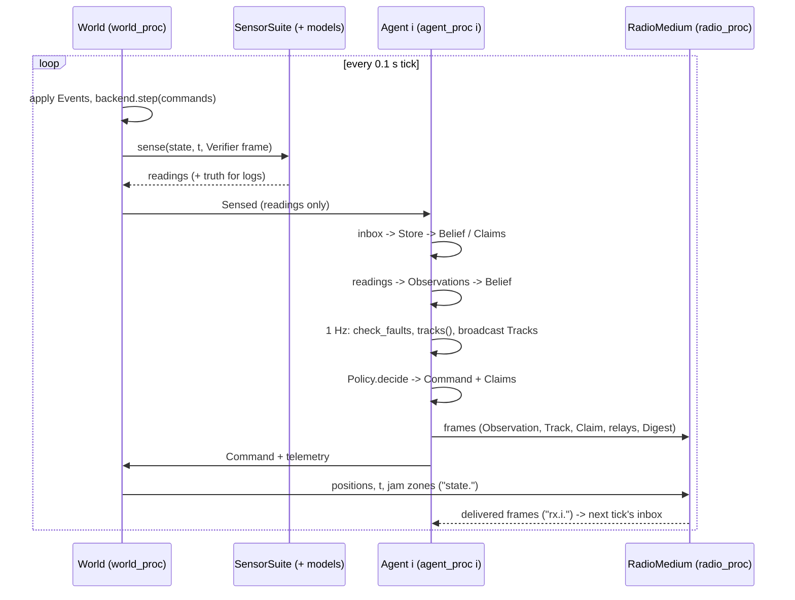

# How Earshot works, end to end

For a reader who has to rebuild the system on the hackathon day. Vocabulary: [CONTEXT.md](../CONTEXT.md). Processes and module seams: [architecture.md](architecture.md). Decisions: [adr/](adr/). Every `file:line` is relative to `src/earshot/` unless it starts with `tools/`, `scenarios/` or `data/`; line numbers are from the `integrate` branch on 2026-10-18 and drift as code changes (the belief and policy constants are still being tuned).

## 1. One second of sim time

The world ticks every `dt` = 0.1 s. Sensors report once per 1 s window per drone, so in one second each drone gets one window of sound and RF readings (one per detected Source and band) and, as Verifier, one camera verdict, and its Agent extracts Tracks once.

Order within one tick, as the lockstep runner does it (`runners/lockstep.py:75-98`); the live runners do the same across processes:

1. `World.step(commands)` (`world.py:66-93`): apply due and live Events (`_apply_events`), move every drone by the last Command (`backend.step`), fetch the Verifier's camera frame, and run `SensorSuite.sense` per drone. Out come `{id: Sensed}` with readings only, and `world.detections` with the truth behind each reading (logs, metrics).
2. Each `Agent.step(t, sensed, inbox)` (`agent/core.py:87-159`):
   1. radio in: each frame through the Message Store (duplicate filter, relay scheduling), then into the Belief (Observation), the received-Track table (Track), the Claim table (Claim), or healing (Digest, Request) (`core.py:218-234`);
   2. own readings become Observations: each sensor at most once per second (`OBS_MIN_INTERVAL` 1 s with `OBS_SLACK` 0.15 s), and the readings of one window share their frames, up to two per Observation (`core.py:34-35, 99-112`); fused into its own Belief and sent;
   3. once per second (`TRACK_INTERVAL`): Faulty Sensor check, Track extraction, broadcast of the Tracks that changed (`core.py:109-126, 168-186`);
   4. Policy decides Mode, Command and Claims from own plus received Tracks, merged (`core.py:128-134, 194-214`);
   5. relays and healing resends that are due, and every 10 s a Digest (`core.py:136-144`).
3. `RadioMedium.step(t, positions, outgoing, jam)` (`radio/medium.py:123-140`) queues the new frames, starts what may start, and delivers what finished. Deliveries are the next tick's `inbox`.

Windows are staggered across drones by 0.137 s per id (`sensors/__init__.py:118-123`), so six drones do not all report in the same tick.



Live: each process loops on its own; an agent that falls behind steps once on the newest tick with every queued reading (`runners/agent_proc.py:25-31, 99-103`), and a drone without a fresh Command keeps its last one.

## 2. Sensors

All sensor models live in the world process. A reading is a `SensorReading(sensor, bearing, bearing_sigma, class_probs, level)` (`messages.py:85-94`: what an Observation carries); `class_probs` is indexed by Target Class (Drone, Vehicle, Train, Nothing).

### Sound

Level model (`sensors/acoustics.py:59-63`):

    Lp = Lw - (20 log10 d + 11) - a_cls * d / 1000 - min(n_buildings * loss_cls, 25 dB)

| Class | absorption dB/km | building loss dB | SNR50 dB | perched bearing σ |
|---|---|---|---|---|
| Drone | 3.7 | 20 | -8 | 5° |
| Vehicle | 0.7 | 10 | -9 | 15° |
| Train | 0.5 | 10 | -9 | 15° |
| Nothing (Nuisance) | 3.7 | 20 | -8 | 5° |

(`acoustics.py:35-40`). Sound power defaults: drone 82, vehicle 105, train 120, Nuisance 75 dB(A); a larger drone is 89 (`acoustics.py:43-48`). Source heights above ground for line of sight: drone 30 m, vehicle 2, train 3 (`sensors/__init__.py:33-34`). Sound and RF share one building count per Source (`sensors/__init__.py:103-104`).

- Noise = background (Scenario `environment.background_db`) ⊕ ego-noise ⊕ every other Source 6 dB down (`MASKING_OFFSET_DB`, `sensors/__init__.py:134-139`).
- Ego-noise: 85 dB at hover rpm (6000), +20 log10(rpm/6000); motors off (perched) = none; the ego filter subtracts `ego_filter_db` (8 dB in the scenarios) (`acoustics.py:52-53, 66-75`).
- Detection per window: logistic((SNR - SNR50) / 2 dB) (`acoustics.py:84-85`).
- Bearing: Gaussian error with σ from the table when perched, 25° when flying, growing up to ×3 as SNR falls toward SNR50 + 10 dB (`acoustics.py:88-92`). Outliers uniform over 360°: 5 % perched, 25 % flying (`acoustics.py:55-56, 95-96`). Level noise 2 dB.
- Class: without a classifier, `_class_probs` draws a predicted class from the `CONFUSION` row of the true class, blended toward uniform at low SNR, and reports confidence 0.4-0.9 for it (`sensors/__init__.py:44-49, 171-178`). The Nuisance row sends 35 % to Drone. With a classifier (`audio.classifier` in the Scenario, or `--classifier`), each detected Source's beam (it, the others 6 dB down, background and ego-noise, rendered at 16 kHz from `data/sounds/` or synthetic loops; `sensors/waveform.py:40-45`) goes through EfficientAT mn10 + the trained head, folded onto the 4 classes (`audio/classifier.py:28-45, 200`). It draws no random numbers. Results: [sound-classifier-spike.md](sound-classifier-spike.md).
- Faults: `deaf` (no sound or RF), `stuck_bearing` (bearing 0°), `phantom` (a 30 % chance per window of a drone-like bearing in a random direction) (`sensors/__init__.py:101-110, 156-157`).

### RF

Passive energy per band, nothing decoded (`sensors/rf.py`):

| Band | Sensor | EIRP | noise floor |
|---|---|---|---|
| `2g4` | RF_2G4 | 20 dBm (video downlink) | -85 dBm |
| `5g8` | RF_5G8 | 14 dBm (analog FPV) | -85 dBm |
| `915` | RF_915 | 30 dBm (control link) | -105 dBm |
| `uhf` | RF_UHF | 33 dBm (handheld radio, 450 MHz), on air in 40 % of windows | -63.5 dBm |

(`rf.py:34-38`). Received power = EIRP - FSPL(1 m) - 10 n log10 d + shadowing, n = 2.5 line of sight / 3.0 through buildings, shadowing σ 3 / 6 dB (`rf.py:40-52`). Detection: logistic around SNR -14 dB, 85 % at -12 dB (`rf.py:42-43, 55-57`). A detection is a reading with no bearing (NaN), the power as `level`, and class probabilities fixed at 0.9 for the band's emitter class (`Band.emitter`: Drone for the drone links, Vehicle for UHF handhelds). Only Sources with `rf:` bands emit. The UHF band (the savanna Reserve, [savanna.md](savanna.md)) reaches 50 % at 2.5 km in the open, 0.7 km behind a kopje.

### Camera

The camera reports only while the drone is in Verify with the camera on. The Policy turns it on within 150 m of the Verify point (`agent/policy.py:299-302`); the backend holds the Verifier `standoff` metres from that point, facing it (`backend/twin2d.py:108-117`; 40 m default, `camera.standoff` overrides).

Three paths, chosen per frame (`sensors/__init__.py:201-246`):

- **Ground-truth stand-in** (2D twin, fast mode, Gazebo; Webots with `--camera truth` and no recogniser): every Source within `CAMERA_RANGE` 100 m is seen with probability 0.9 (`sensors/__init__.py:37-38`). Webots' recogniser, when present, replaces the 0.9 draw: a class is seen if the rendered recogniser reports it (Recognition `maxRange` 100). A hit is a bearing (σ 2°) with 0.95 for the true class; no hit is one "nothing" reading (NaN bearing, Nothing = 1).
- **YOLO detector** (Webots with `camera: {detector: yolo}`; `sensors/camera.py`): drone-yolo-v1 (YOLOv8n, classes quadcopter and fixed-wing) with ByteTrack on every `every`-th rendered Verifier frame (`camera.py:86-116`). Only `quadcopter` counts.
  - Hit (streak): a track counts once ByteTrack has followed the same id at `verify_conf` or more for `confirm_frames` processed frames in a row; a missed frame resets its streak (`camera.py:108-116`). Each window's verified tracks become drone bearings from the box centre, σ = max(2°, half the box's angular width) (`camera.py:41-52`).
  - Clear: "nothing here" only after `clear_windows` (3) windows in a row with no quadcopter box at all while the Verifier holds still (moved ≤ 5 m in the window, `CAMERA_HOVER_M`; the approach does not count), and only out to `clear_radius`, carried in the reading's `level` (`camera.py` `verdict`, `sensors/__init__.py` `_detected`).
  - Inconclusive (some box, none verified; or a second Verifier without the single rig's images): no camera reading at all. The policy's `verify_timeout` bounds such a sortie.
  - Anything in between is no reading: inconclusive.
  - Defaults `conf` 0.25, `verify_conf` 0.5, `confirm_frames` 3, `clear_windows` 3, `clear_radius` 40 m, inference size = image width (`camera.py:56-66`). `scenarios/muc_full.yaml` sets `verify_conf` 0.5, `every` 2, 1280x768, `standoff` 25.
  - Tracks and streaks reset whenever a sortie ends (camera off or another Mode) or another drone takes the rig (`SensorSuite._feed_detector`), so nothing seen on one sortie can verify the next. The rig stays with its Verifier until that camera goes off (`webots.py` `_push`).
  - A detector that raises at run time is dropped for the stand-in, with one message; `warm()` runs one inference at load so a missing tracker package or device error shows at start.
- Truth for the logs: the active Source within 100 m nearest in bearing, within 5° (`CAMERA_MATCH_DEG`).

Measured ranges of drone-yolo-v1 on Webots Verifier views, quadcopter class, 4 views per distance ([verifier-highres REPORT](../data/cv/verifier-highres-20261015/REPORT.md), [evaluation REPORT](../data/cv/verifier-demo-20261015/evaluation/REPORT.md)):

| Distance | 400x240, inference 640 | 1280x768, inference 640 | 1280x768, inference 1280 |
|---|---|---|---|
| 5 m | 4/4 | 4/4 | 4/4 |
| 15 m | 3/4 | 3/4 | 3/4 |
| 30 m | 1/4 | 1/4 | 4/4 |
| 60 m | 0/4 | 0/4 | 2/4 |
| 90 m | 0/4 | 0/4 | 1/4 |

No quadcopter false detections on the 10 empty stills; on the moving video a tree was tracked as fixed-wing throughout, and track ids were not kept across a 1 s gap. That is why `clear_radius` is 40 m, the Verifier closes in to 25 m, and only the quadcopter class counts.

## 3. Probability Map (`agent/belief.py`)

One per drone, a grid of `map_cell` metres (20 m default, 25 m in Munich) over the City. Per cell and threat class k (Drone, Vehicle, Train), a log-odds against "nothing here" (`belief.py:13-37`):

    logit_k = prior_k + Σ_(o,f) G_o,f,k · min(1, N_EFF · D_o,f / W_o,f) + C_k

- **Per (origin, sensor family).** G is the summed log-likelihood ratio from origin o (one drone) through family f (sound or RF); W is how many readings covered the cell. Correlated readings from one static sensor count as at most `N_EFF` = 1.5 independent readings: the sum while few, the average × 1.5 after (ADR 0006; `_contribution`, `belief.py:433-439`). D = exp(-(t - newest reading of o,f) / TAU) makes a silent sensor fade. Everything decays with `TAU` = 30 s; late Evidence enters already decayed by its age (`belief.py:282-323`). Sums are order-independent, so arrival order never matters.
- **Sound** (`belief.py:329-343`): a Gaussian wedge around the bearing (σ = the reading's, at least 2°), mixed with an off-line floor of 0.6 ("maybe another source"), as a log density ratio against uniform; weighted by the class probability; only within the hearing range for that class and perched/flying (computed at 40 dB background, the loudest source of the class, `belief.py:90-105`).
- **RF** (`belief.py:345-357`): a ring at the distance the band's path loss implies (both exponents, σ 7 dB); log-likelihood +2.2 on the ring, -0.7 off it; Drone class only.
- **Priors** (`belief.py:65-67, 254-267`): Drone -5 everywhere; Vehicle -2 within 25 m of a road, -8 elsewhere; Train -2 within 30 m of rail, -10 elsewhere. With N_EFF 1.5 and the -5 drone prior, one bearing line alone cannot make a Suspicion; two crossing lines can.
- **Camera** C (`belief.py:359-381, 441-452`): capped the same way per camera, fading with `TAU_CAMERA` = 120 s. A hit adds a blob along its bearing (+6 × class probability, Gaussian in bearing with σ 15°, within 100 m) and, if it is of the Threat Class, records a confirmed point where the camera is. A hit that ranged a ground target (`level` > 0: metres; the stand-in with a Scenario's `camera.range`, a thermal camera that geolocates a vehicle from its height and the depression angle) adds the blob around the point it geolocated (σ = max(cell, 10 % of the range)) and puts the confirmed point there. A "nothing" subtracts 8 over the disc it cleared (the reading's `level` if > 0, else 100 m) and drops confirmed points there, unless the camera saw the drone within the last 2 s (`CONFIRM_GRACE`, `_unconfirm`).
- **Confirmed points** (`belief.py:396-418, 482-488, 615-640`): a camera hit near an existing point (within `CONFIRM_FOLLOW` 150 m) moves it; elsewhere it starts one. A neighbour's Confirmed Track only nudges an existing point, at most `CONFIRM_SPEED` 15 m/s, and never extends its life. A point expires 120 s after its last camera sighting (`CONFIRM_HOLD`).
- **Explaining away** (`_status`): a Vehicle or Train Suspicion within 60 m of a road or rail line, or within its own semi-major axis of one (a vehicle heard from 2 km lands beside its road), is Explained. A drone peak within 150 m of a confirmed point, other than the one that point follows, is Explained as its side lobe.
- **Track extraction** (`tracks`, `belief.py:555-613`): repeatedly take the highest threat probability peak (stop below 0.3; at most 6 Suspicions and 6 Explained peaks, so an explained trail cannot crowd out a Suspicion); weight cells within 150 m by relative likelihood exp(z - z_peak) (cells under 0.05 dropped, cells already claimed by a stronger peak excluded); the weighted mean is the position, the weighted covariance the ellipse (2σ); class by posterior mass; `strength` = threat log-odds at the peak; `support` lists each (origin, family) contribution for the dashboard. Cells within 200 m of a peak are suppressed for the next. Then `_follow_confirmed` sets statuses, and `merge_overlapping` joins overlapping drone Suspicions.
- **Merging** (`merge_overlapping`, `belief.py:139-216`): clusters form around their strongest member, never by chaining; members overlap the seed's ellipse; the merged position is the mean weighted by exp(strength); Confirmed merges only with Confirmed. The Agent applies it again to own plus received Tracks (`core.py:194-214`). Task ids come from the 100 m cell of the merged position (`cell_id`, `belief.py:126-130`).
- **Faulty Sensor** (`check_faults`, `belief.py:492-536`): for each origin with at least 8 bearings in the last 30 s, check the tight Tracks (≤ 100 m) the other drones reach on their own (log-odds ≥ 8) that it should hear while perched; if fewer than 10 % of its bearings point at any of them for 5 consecutive checks, its Evidence is excluded until a bearing agrees again.

## 4. Policy (`agent/policy.py`)

**Modes.** Listen (perched on the Perch Site nearest its home, motors off), Patrol (circle in its Sector), Fill Gap (Patrol in a Sector that grew), Verify (fly to a Suspicion, camera on within 150 m). Fixed (array) drones always Listen (`policy.py:91-95, 121-123`).

**Tasks** (`_tasks`, `policy.py:140-165`). Drop Confirmed Tracks and every Track within `confirmed_shadow` of a confirmed one; keep drone Suspicions, strongest first, the top `top_suspicions`; a Suspicion with confidence ≥ `verify_min_confidence` and strength ≥ `verify_min_strength` becomes a Verify task with id `kind × TASK_STRIDE (16384) + cell` (`policy.py:54-62`).

**Auction** (`policy.py:167-208`). Bid = 655 - metres / 10, rounded as the Claim carries it: the nearest drone bids highest, ties to the lower id. Rivals are other drones' active Claims of the same kind within `same_task_radius` + 100 m: the auction is by place, not task id. A free drone claims its best task that no rival holds with a higher bid.

**Lease, settle, renew, release** (`_continue`, `policy.py:212-241`). A Claim carries a 10 s lease (`LEASE`). The drone flies only after holding the best bid for `settle` seconds ("dispatch"). It sends its Claim again halfway through settle, so one lost frame cannot let a rival settle too, and renews every 4 s (`RENEW`) after. A nearer rival makes it release at once (lease 0, "outbid") and stay away from that place for `outbid_cooldown` (`policy.py:184-187, 226-232`). A silent drone's lease lapses and others bid.

**Holding and drift** (`policy.py:243-257, 214-217`). A claimed task follows its Suspicion: same id, else the nearest task within `same_task_radius`, else any likely drone Suspicion that close, below the strength gate too. If it has moved more than `same_task_radius` from where it was claimed, it is released ("drifted") and re-auctioned.

**Outcome** (`_verify_progress`, `policy.py:259-273`): a Confirmed Track within 80 m of the task → "confirmed"; arrived (within `arrive`) and no Suspicion left for `dismiss_after` → "dismissed"; arrived and neither confirmed nor dismissed after `verify_timeout` → "timeout" (the place is then left alone for `outbid_cooldown`; the dashboard counts it as dismissed); Suspicion gone before settling → "obsolete". With `follow_for` > 0 (the Reserve) a confirming Verifier keeps its task instead (Follow): it keeps a Quarry (`agent/follow.py`: position and velocity from its own camera hits and the nearest Confirmed Track of the Threat Class), faces it, asks for its speed plus `follow_gain` per metre beyond `follow_gap` (at most `follow_max_speed`), renews its Claim and reports "following" once a second, until `follow_for` has passed ("handed_off") or neither its camera nor a Confirmed Track has seen it for `dismiss_after` ("lost").

**Sectors** (`policy.py:304-331`): Voronoi cells over 100 m cells of the homes of drones without an active Claim; a patroller circles at 0.35 × the equivalent radius around its cell's centroid, and flies Fill Gap when its cell is larger than with the full swarm.

**Baselines** (`SwarmConfig.policy`): `nearest` verifies every non-confirmed Track of any class above `verify_min_confidence`, no strength gate, no explaining away; `no_perch` never perches.

A drone bids on no task further than `max_verify_distance` (off by default; 3 km in the Reserve, where Claims lost on a busy channel otherwise sent drones across the map).

Tunable numbers are `state.PolicyParams` (`state.py:66-88`): `verify_min_strength` 4, `verify_min_confidence` 0.5, `top_suspicions` 2, `confirmed_shadow` 200 m, `settle` 3 s, `same_task_radius` 200 m, `arrive` 60 m, `dismiss_after` 8 s, `outbid_cooldown` 5 s, `verify_timeout` 90 s. A Scenario's `params:` or `--params FILE` overrides them.

## 5. Radio

**Frames** (`messages.py`; ADR 0004): header 5 B (type, origin, seq u16, hops_left) + payload + 10 B truncated HMAC-SHA256; `hops_left` is outside the tag so relays can decrement it. Airtime at SF7, CR 4/5, 8-symbol preamble (`radio/medium.py:51-59`):

| Type | Size | Airtime 500 kHz | Airtime 125 kHz | Hops | Stored / healed |
|---|---|---|---|---|---|
| Observation, 1 reading | 32 B | 18.0 ms | 71.9 ms | 1 (`ours`) | stored, not healed |
| Observation, 2 readings | 40 B | 20.5 ms | 82.2 ms | 1 (`ours`) | stored, not healed |
| Track | 32 B | 18.0 ms | 71.9 ms | 3 | stored, healed |
| Claim | 29 B | 16.7 ms | 66.8 ms | 3 | stored, healed |
| Digest (6 entries) | 38 B | 20.5 ms | 82.2 ms | 1 | no |
| Request | 20 B | 14.1 ms | 56.6 ms | 1 | no |

An Observation is one drone's readings of one sensor window (`Observation.MAX_READINGS` 2): time, position and Mode once (9 B), then 8 B per reading: sensor (3 bits) and bearing (13 bits) in one u16, bearing σ, P(drone, vehicle, train) and `level`; P(nothing) is what the three leave, since every producer's class probabilities sum to 1. A window with three readings sends two Observations. Most windows carry one reading (78 % of observing drone-seconds in the reserve, 76 % at Munich, 82 % in the demo); the rest are mostly sound+sound, UHF+sound or camera+UHF. Before 2026-10-21 every reading went in a 35 B frame of its own.

Quantisation: positions 1 m, Observation bearing 0.044°, bearing σ 0.5°, probabilities 1/255, Track axes 5 m, strength 0.1 log-odds up to 25.5, Observation `level` 0.01 (dB, dBm, or the camera's cleared radius in m).

**When frames are sent** (`agent/core.py:34-47`): Observations once per sensor window, each sensor at most 1 Hz, its readings together; up to 3 Tracks of the Threat Class per second, re-sent when changed, moved by 50 m, or every 10 s, and not when a neighbour said the same within 10 s (Trickle-style); Explained ones one hop only, at most one per 300 m every 30 s; Claims as the Policy decides; a Digest every 10 s, rotating through origins.

**Medium** (`radio/medium.py`, defaults in `RadioConfig`, lines 31-44):

- Per-sender queue by priority Claim > Request > Track > Observation > Digest, FIFO within one, 32 deep (`medium.py:62-78, 130-136`).
- Each frame gets one start jitter of 0-0.3 s when handed in (no listen-before-talk).
- Half duplex, one frame on air per sender, 10 % duty cycle over 10 s.
- Link budget: path-loss exponent 2.9, transmit power set so the median power at `nominal_range_m` equals sensitivity (700 m default, 1200 m in Munich).
- Shadowing σ 6 dB, drawn once per (frame, receiver), so a link has the same power as wanted frame and as interferer (`medium.py:191-198`).
- A frame is lost if either end is in a Jam Zone, the receiver was transmitting during the overlap, it is below sensitivity, or it does not beat the summed power of all overlapping frames by 6 dB (capture, `medium.py:200-238`). `margin_db` (power above sensitivity) goes to the receiver.

**Relaying** (`agent/store.py:39-46, 82-129`), scheme `ours`: a receiver that heard the frame more than 20 dB above sensitivity does not relay (the sender is close). Others wait 0.05 s + 1.2 s × (margin / 30 dB) + 0.01 s × id, so far receivers relay first. Anyone who hears the relay before its own turn cancels. `flood` relays at once; `unicast3` sends every frame three times. With a Scenario's `radio.relay_radius_m` (the Reserve: 4 km) a Track or Claim is relayed only by drones within that distance of its place (healing still resends it: holding that back too lost poachers in the evaluation).

**Healing** (`store.py`): a Digest lists the newest seq held per origin (own frames included) of the frames worth healing, Claims and Tracks that are not Explained (Observations and Explained Tracks go one hop: a drone out of their range never gets them and must not keep asking), compared modulo 65536 (`seq_newer`): seqs wrap after 65536 frames, about 55 min at 20 frames/s. The store forgets frames after `HORIZON` (600 s), so a wrapped seq is a new frame, not a duplicate, and memory stays bounded in a run that goes on for hours. A receiver missing some sends a Request for at most 20 seqs, at most once per origin per 30 s. Holders resend up to 5 of the newest Tracks/Claims in that range, 1 hop, each frame at most once per 10 s, staggered by id so one answers and the others overhear.

## 6. Evaluation and tuning

`earshot eval` (`eval.py`) runs seeded lockstep runs per policy (and scheme, bandwidth, classifier) and prints median [min-max] over seeds. Per run (`eval.py:1-24, 89-116`):

- `t_confirm`: per drone Source, s from its appearance to the first camera confirmation within 100 m of it; averaged over all drone Sources; a Source never confirmed counts as the scenario's `duration` (censored, `censored_mean`, `eval.py:65-67`).
- `t_dispatch`: the same for the first Verify dispatch within 150 m.
- `confirmed` / `missed`: drone Sources confirmed / never confirmed.
- `loc_err`: median over all dispatches of the distance to the nearest drone Source in the air.
- `false_verify`: dispatches with no drone Source within 150 m. `verify_flights`: all dispatches.
- `busy_max`: most drones away from their post at once (the Gap).
- `load`, `clean_rx`: channel load; delivered / (delivered + collided).
- `t_agree`: after the last jam ends, s until all drones' top Suspicions agree within 100 m; never agreeing counts as `duration` - jam end with `agreed` False; no jam → none.
- `battery_used`.

Seeds: `--scenario random` generates a world per seed from `scenarios/demo.yaml` (`scenario_gen.py`: one intruder away from roads and rail, 80 % with RF, trains, vehicles, Nuisances, a Jam Zone in half the runs, a second intruder 250-500 m away in 30 %). Tune trains on seeds 0-9 (`TRAIN_SEED0`, `TRAIN_RUNS`) and checks on held-out seeds from 1000 (`HOLDOUT_SEED0`). `eval --params` defaults to the held-out seeds and warns on overlap with training seeds (`cli.py:190-201`). `--jobs N` runs seeds in parallel with identical rows, not with `--classifier`. `--duration` overrides the length. `eval` uses a sound classifier only from `--classifier`, not from a Scenario's `audio:`.

`earshot tune` (`tune.py`): CMA-ES over eight genes of `PolicyParams` in bounded ranges (`tune.py:38-47`; `arrive` ≥ 45 m so a Verifier at the default 40 m standoff can arrive). Cost per run = censored `t_confirm` + 600 × missed + 10 × false verifies + 10 × `busy_max` (`tune.py:48-50, 69-74`). Generation 0 is the default; at the end default and best are compared seed by seed on the held-out seeds. Output in `runs/tune-<time>/`. Tuned sets: `scenarios/params/`, written up in [tune-2026-10-18.md](tune-2026-10-18.md) and [tune-2026-10-18b.md](tune-2026-10-18b.md).

Judge a behaviour change with `earshot eval` over seeds, one change at a time.

## 7. Dashboard

`earshot live` starts it at http://127.0.0.1:8000 (`dashboard/server.py`). It reads the world's `state.` and the radio's `radio.` topics and sends Events back through `POST /control`; Agents never see it.

- `/` (`static/hud.html`): the game screen. A map scope with drones, Modes, links, Jam Zones, Suspicions and (toggled) the Probability Map and ground truth; the main drone view and three tiles from Webots or Gazebo view cameras (map first when there are no camera images); a pipeline line with Readings (30 s), Suspicions, Verifications and Confirmed; a top-Suspicion line; a ticker of decisions and Events; a banner when an intruder is confirmed. The Evidence screen (`x`) shows the selected drone's top Suspicion with each (origin, sensor family) contribution in log-odds, and every drone's frequencies.
- `/classic` (`static/index.html`): the older operator console, with the Verifier camera preview every 5 s.
- Counters come from `world_proc.VerifyCounts` (`runners/world_proc.py:40-73`): distinct verify tasks dispatched, distinct tasks confirmed or dismissed ("Verifications"), distinct intruders confirmed (confirmations within 150 m count once), dismissed.

Hotkeys (`hud.html:229-243`, handled at 997-1017):

| Key | Action |
|---|---|
| `0`-`9`, `Tab` | select a drone / next drone |
| `c` | main view: pilot or chase |
| `x` | live view or Evidence screen |
| `h`, `g` | Probability Map, ground truth on the scope |
| `l` | listen to the selected drone's microphone (needs `--audio`) |
| `d` `v` `t` `n` | add a drone, truck, train, fan at the mouse |
| `j` / `J` | jam here / clear jamming |
| `f` / `F` | stick the nearest drone's microphone / clear faults |
| `b`, `e` | day/night background (40 / 55 dB), ego-noise filter |
| `?` | help |

## 8. How to run Munich

Base setup: [README.md](../README.md). The integrated scenario is `scenarios/muc_full.yaml`.

Install the model groups and fetch the assets that are not committed:

```bash
uv sync --group ml --group cv
uv run python tools/fetch_efficientat.py      # data/models/mn10_as_mAP_471.pt (~20 MB)
uv run python tools/fetch_sound_data.py       # data/sounds/ real recordings (~1 GB download)
```

Committed already: the trained sound head `data/models/sound_head.pt` and the camera weights `data/cv/verifier-demo-20261015/evaluation/drone-best.pt`. Without `data/sounds/` recordings the mixer uses synthetic loops; the classifier still runs.

Fast mode (one process, no sockets; the camera is the ground-truth stand-in, sound uses the Scenario's classifier):

```bash
uv run earshot fast --scenario scenarios/muc_full.yaml --duration 120
```

Live on the 2D twin (sound classifier on, camera stand-in):

```bash
uv run earshot live --scenario scenarios/muc_full.yaml
```

Live in Webots with the full perception (EfficientAT sound, YOLO Verifier camera at 1280x768). The first build of the Munich world takes about 3 min; after that it loads from the cache (`webots/worlds/muc_full_assets/build.hash`) in under a second:

```bash
uv run earshot live --scenario scenarios/muc_full.yaml --backend webots
```

Add `--no-webots-view` when the dashboard is the show. The world loads 5 Webots PROTOs from GitHub (`EXTERNPROTOS` in `tools/build_webots_world.py`); Webots caches them on the first online launch, so launch each demo Mac once with network before the venue.

Fallbacks, from least to most drastic:

- A missing model or group is reported at start-up and replaced by its stand-in (`[sensors] ... unavailable`); the run goes on.
- `--camera truth` or `--classifier none` turns a model off on purpose.
- `EARSHOT_SOUND_DEVICE=mps` and `EARSHOT_CV_DEVICE=mps|cpu` pick the devices.
- `--params scenarios/params/tuned-2026-10-18.json` tries a tuned policy set.
- If Webots quits mid-run, the world goes on in the 2D twin without camera images.
- If Webots will not start, run on the twin (drop `--backend`), or the plain `scenarios/muc.yaml`.

## 9. Known limitations and realism

Summary of [review-2026-10-18.md](review-2026-10-18.md) section 3; sources are in its section 11.

- **Airport background.** The Munich scenarios use a constant 40 dB(A) ("night"); a real apron is 65-75 dB(A). At 65 dB the model's own math gives an 11 m hearing range.
- **RF is close to a drone oracle.** Every RF hit is reported as 90 % drone (`sensors/__init__.py:194-195`), while an airport's 2.4/5.8 GHz is full of Wi-Fi and fibre-optic, LTE or autonomous drones emit nothing. The detection threshold (SNR -14 dB) is below what an energy detector can do.
- **915 MHz range.** 30 dBm against a -105 dBm floor detects at about 50 km line of sight, 8 km through buildings; commercial sensors reach 1-5 km.
- **LoRa settings.** 500 kHz bandwidth at 10 % duty cycle is not legal in EU868 (1 % at 25 mW; the 10 % sub-band is 250 kHz wide). It is fine under US FCC 15.247.
- **Camera range.** The stand-in sees 100 m with 90 % detection; the measured YOLO range on 1280x768 frames is about 30-60 m (section 2). The twin2d run of `muc_full` therefore still uses the optimistic stand-in.
- **Perched bearing σ** 5° is optimistic for a 4-mic, 6 cm array (8-15° is defensible); echoes are modelled as random outliers, not mirror bearings.
- **No wind or rain.** Wind noise dominates below 500 Hz.
- **Instant perching** that never fails; separate flying and perched battery models; a 15 m/s Verifier that a fast intruder outruns.
- **Legality** of flying near an airport is not addressed.

## 10. Third-party models and licences

| Component | Where | Licence | Notes |
|---|---|---|---|
| EfficientAT mn10_as (code and weights) | `audio/efficientat/` (vendored code), `data/models/mn10_as_mAP_471.pt` | MIT | `audio/efficientat/LICENSE`. |
| AudioSet labels | `audio/efficientat/audioset_labels.csv` | CC BY 4.0 (verify) | Google's AudioSet dataset is CC BY 4.0; the ontology is CC BY-SA 4.0. Verify which applies to the label CSV. |
| Trained sound head | `data/models/sound_head.pt` | trained partly on ESC-50, CC BY-NC 3.0 | Non-commercial: fine for the hackathon demo, not for a product. Declared in DECLARATION.md. |
| ESC-50 | `data/raw/sounds/`, `data/sounds/` (gitignored) | CC BY-NC 3.0 | `tools/fetch_sound_data.py`. |
| DroneAudioSet | `data/raw/sounds/`, `data/sounds/drone/` (gitignored) | MIT | `tools/fetch_sound_data.py`. |
| TomSmail/drone-yolo-v1 | `data/cv/verifier-demo-20261015/evaluation/drone-best.pt` | CC BY 4.0 | Credit FRAID Labs / TomSmail; unmodified checkpoint, SHA256 in `summary.json`. Trained with Ultralytics: verify whether AGPL terms reach the weights. |
| Ultralytics (YOLO runtime, ByteTrack) | `cv` dependency group | AGPL-3.0 (verify) | Not stated in the repo. AGPL: shipping it in a product, or serving that product over a network, means publishing the product's source under AGPL, or buying an Ultralytics commercial licence. |
| DINOv2-small (`facebook/dinov2-small`) | `tools/cv_navigation.py` | Apache-2.0 (verify) | Offline tool only. |
| Depth Anything V2 Metric Outdoor Small | `tools/cv_navigation.py` | Apache-2.0 (verify) | Offline tool only. The Small models are Apache-2.0; Base and Large are CC BY-NC 4.0. Verify the metric fine-tune's card. |

## Results (paired evaluation, 2026-10-19)

Same seeds (held out from tuning: random worlds 1000-1019, `muc.yaml` and `two_drones.yaml` at seeds 1000+), same corrected metrics (section 6), default PolicyParams, stand-in sound and camera (lockstep). "Before" is the merge (3e608ff) scored with the new `eval.py`; "all fixes" adds every review fix; "shipped" holds back fix A and adds the sortie and camera safety of 553c847. Medians over runs; confirmed counts drone Sources.

| Set | Variant | Confirmed | t_confirm s | False verifies | Flights | Drones away (max) |
|---|---|---|---|---|---|---|
| random, earshot | before | 15/26 | 173 | 21 | 28 | 5 |
| | all fixes | 21/26 | 71 | 49.5 | 58.5 | 6 |
| | **shipped** | 16/26 | 170 | 19 | 29.5 | 4 |
| random, nearest | before | 18/26 | 115 | 28 | 33.5 | 6 |
| | **shipped** | 17/26 | 151 | 24 | 37 | 6 |
| muc, earshot (4) | before | 4/4 | 85 | 26.5 | 29.5 | 4 |
| | all fixes | 3/4 | 205 | 68.5 | 75.5 | 6 |
| | **shipped** | 4/4 | 163 | 22 | 33.5 | 5 |
| two_drones (6) | before | 9/12 | 123 | 26.5 | 41 | 5 |
| | all fixes | 9/12 | 140 | 52 | 68.5 | 6 |
| | **shipped** | 10/12 | 98 | 15.5 | 31.5 | 3.5 |

Reading it:
- Fix A (masked Track weights, non-transitive merge) finds more drones on random worlds only by flying twice as often: RF Ghost side lobes 200-500 m from a confirmed drone become Suspicions of their own. It is held back; its tests stay as strict xfail (`tests/test_belief.py`, `SECOND_DRONE`). It needs a gate that keeps Ghosts from being dispatched first (e.g. two sensor families or a bearing crossing).
- Shipped vs. before: fewer false verifies everywhere, the second drone found more often and sooner, fewer drones away at once. Munich confirms later in 2 of 4 seeds (median 85 -> 163 s, range 86-267 s): not yet explained; candidates are the capped camera evidence and the radio changes (about 25 % more collisions on the demo). Bisect with `earshot eval --scenario scenarios/muc.yaml --runs 8 --seed 1000 --jobs 4` before quoting a Munich time.
- `earshot` is still not faster than `nearest` on random worlds (170 vs 151 s); it flies less (29.5 vs 37) with fewer false verifies (19 vs 24).
- The trained sound head and the YOLO camera are not in these numbers (lockstep has no images, and `eval` uses `--classifier` only). One live Webots run of `muc_full.yaml`: the intruder (from t = 60 s) was a Suspicion at 70 s and confirmed by the YOLO camera at 156 s, located within 48 m; on the evidence screen camera +4.3, RF about +2.5 per drone, sound +0.8 (the head heard the fan on Terminal 1 as "nothing", not as a drone); the dashboard showed 4 Verifications and 1 Confirmed at that point.
